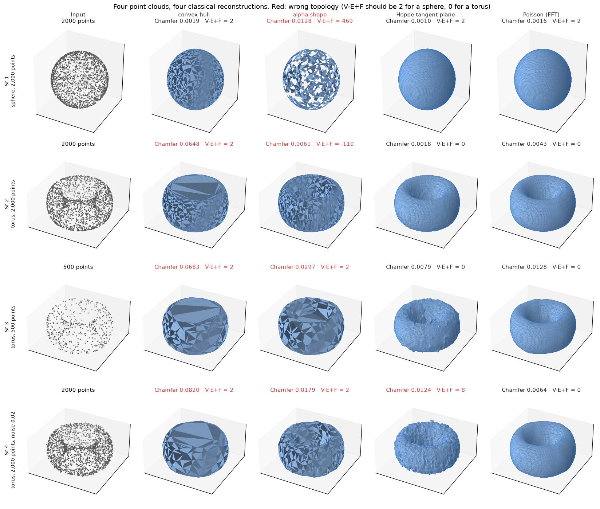
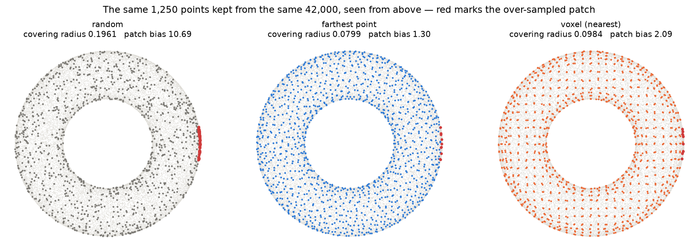
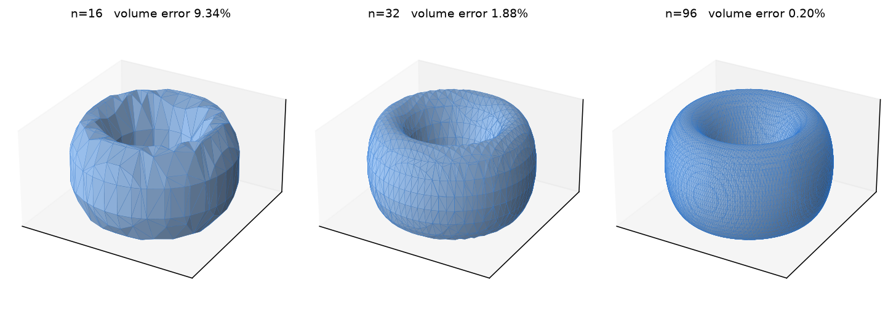
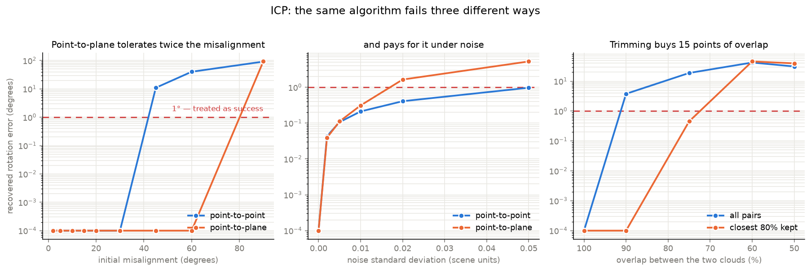

# 3D Computer Vision

We built ten 3-D computer vision projects that reconstruct geometry from images and
point clouds: depth, surfaces, normals, registration, decimation, part segmentation,
novel views and volumetric segmentation. Six are classical (no neural network, CPU
only) and four are learned (run on Kaggle's GPU), and both are held to the same rule:
every number is measured against ground truth that is known in closed form or planted
on purpose. It is for engineers and students who want to know how these methods
actually behave, with numbers, before choosing one.

Notebooks: [kaggle.com/muhammadhammas13/code](https://www.kaggle.com/muhammadhammas13/code)

## Projects

| Project | Kind | Result |
|---|---|---|
| [Marching cubes](projects/marching-cubes/) | classical | error is exactly second order: fitted 2.00-2.05 on both shapes and both variants |
| [ICP registration](projects/icp-registration/) | classical | point-to-plane tolerates twice the misalignment (60 deg vs 30) and is 5.4x worse under noise |
| [Surface reconstruction](projects/surface-reconstruction/) | classical | the convex hull wins on a sphere and cannot represent a hole: 16x more points change its torus error by 4.7% |
| [Normal estimation](projects/normal-estimation/) | classical | angular error falls as k^-1, not the k^-0.5 that averaging k neighbours implies |
| [Point-cloud decimation](projects/point-cloud-decimation/) | classical | Chamfer separates four methods by 1.24x; covering radius separates them by 3.28x |
| [Two-view triangulation](projects/two-view-triangulation/) | classical | a longer baseline buys depth accuracy and nothing else: depth error is 513x lateral at 2 cm |
| [Monocular depth](projects/monocular-depth/) | learned | the alignment protocol moves delta<1.25 from 0.461 to 0.911 on identical predictions |
| [Point-cloud part segmentation](projects/point-cloud-segmentation/) | learned | rare categories average 0.7016 IoU against 0.8249 for common ones |
| [Novel-view synthesis](projects/mesh-or-novel-view/) | learned | 16.78M of 16.79M parameters are the hash table; train views beat held-out by 5.357 dB |
| [Volumetric segmentation](projects/volumetric-segmentation/) | learned | whole-tumour Dice 0.8734 hides enhancing Dice of exactly 0.0000 on 6 of 55 patients |

## What it does

- Classical projects sample analytic surfaces (sphere, torus) or apply a known rigid
  transform, run several methods on the same input, and score them against the exact
  surface: Chamfer distance, topology (Euler characteristic), angular error, cost.
- Learned projects score models on official held-out splits (NYU Depth V2 Kinect depth,
  ShapeNetPart, BraTS 2020, held-out camera views of the NeRF `chair` scene) and report what the number does and
  does not establish.
- `tools/check_readme_numbers.py` checks every number in a project README against
  that project's `results.json`.

## Sample input / output

**Surface reconstruction** - four point clouds (Sr 1-4: a sphere, a torus, a sparse
torus, a noisy torus) and the mesh each classical method builds from them. Each cell
shows the Chamfer distance to the true surface and the Euler characteristic V-E+F;
red means the mesh has the wrong topology:



**Point-cloud decimation** - the same 1,250 points kept from 42,000 by three methods:



**Marching cubes** - the torus extracted at three grid sizes, with the volume error:



## Results

- **ICP:** point-to-plane converges from 60 degrees of misalignment where
  point-to-point stops at 30, and is 5.4x worse under noise; trimming to the closest
  80% of pairs buys 15 points of overlap.

  

- **Monocular depth:** the same predictions score delta<1.25 of 0.461 or 0.911
  depending only on the alignment protocol.
- **Volumetric segmentation:** a whole-tumour Dice of 0.8734 hides an enhancing-tumour
  Dice of exactly 0.0000 on 6 of 55 patients.

## Tech stack

- Python 3.10+
- Classical: NumPy, SciPy (`spatial`, `sparse`), scikit-image (`measure.marching_cubes`),
  OpenCV for two-view triangulation, matplotlib for figures, pytest
- Learned: PyTorch, Hugging Face `transformers` (monocular depth), Kaggle notebooks on GPU

## Run it

Classical projects (CPU, no downloads):

```bash
git clone https://github.com/hammasbuilds/3d-computer-vision.git
cd 3d-computer-vision
pip install numpy scipy scikit-image opencv-python-headless matplotlib pytest

cd projects/surface-reconstruction
python run.py        # all sweeps, writes results/results.json
python figures.py    # rebuilds the figures
cd ../..
python -m pytest projects/ -q
python tools/check_readme_numbers.py projects/surface-reconstruction
```

Learned projects are notebooks that run on Kaggle; each project README links its
notebook, for example
[monocular depth](https://www.kaggle.com/code/muhammadhammas13/monocular-depth-vs-ground-truth)
and [volumetric segmentation](https://www.kaggle.com/code/muhammadhammas13/3d-unet-brats-dice).

## Licence

No licence file is included, so the code is all rights reserved. Datasets used by the
learned projects (NYU Depth V2, ShapeNetPart, BraTS 2020, the NeRF Blender scenes)
belong to their authors.
